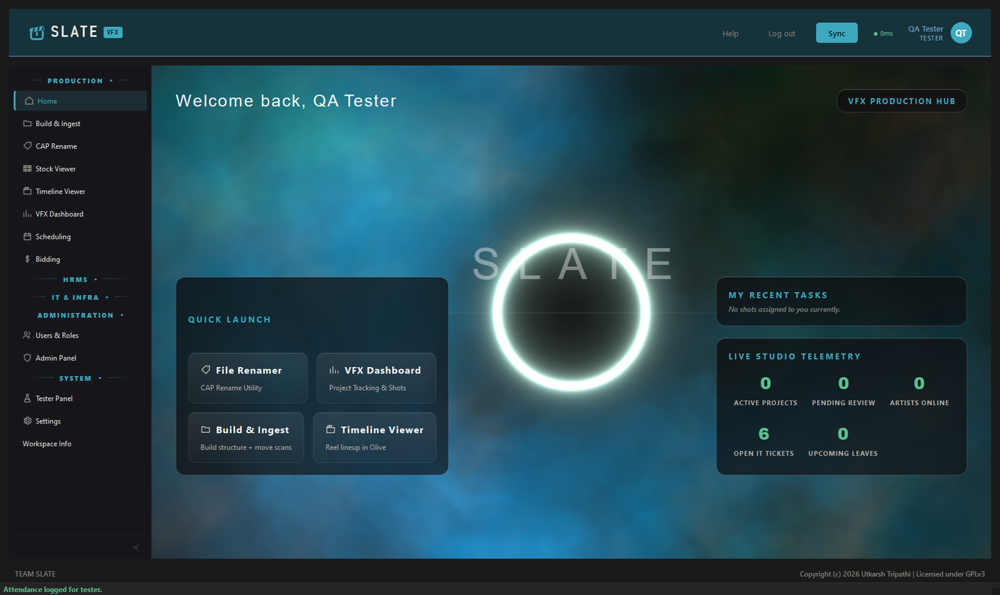
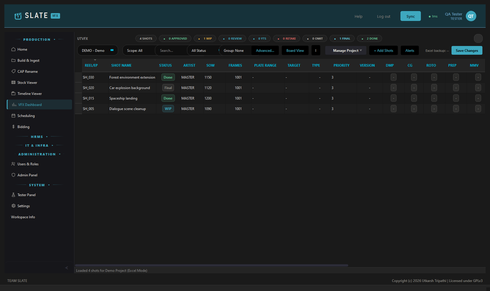
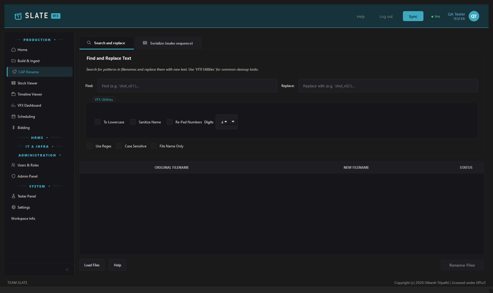
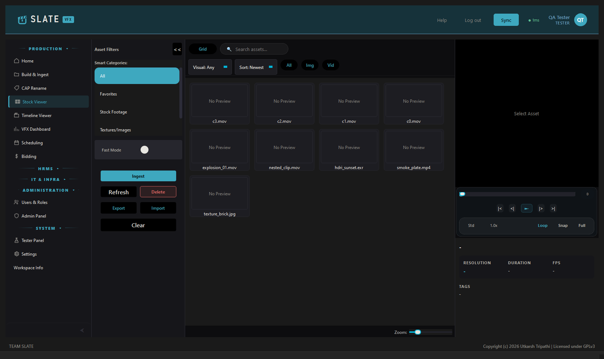
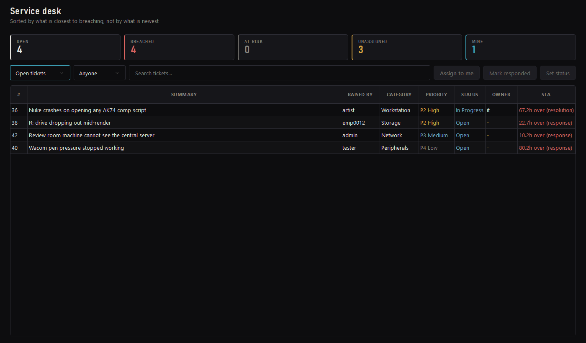

# Slate

A VFX studio pipeline and office app for Windows: shot tracking, reviews, bidding, attendance and more, running on your studio's own server.

## Download

Get the latest setup from **[Releases](https://github.com/capsuleutkarsh-design/Slate/releases/latest)**. Download every file of the release into one folder, then run the `.exe`.

Website and guide: https://capsuleutkarsh-design.github.io/slate-vfx/

## Screenshots

**Home**

**Dashboard**

**Shot rename**

**Stock**

**Service desk**

## Licence

Slate is free to use, made by Utkarsh Tripathi. It is not for sale. Please do not re-upload the setup or remove the author's name. The full licence is shown in the installer.

Questions and bug reports: [capsuleutkarsh@gmail.com](mailto:capsuleutkarsh@gmail.com)
